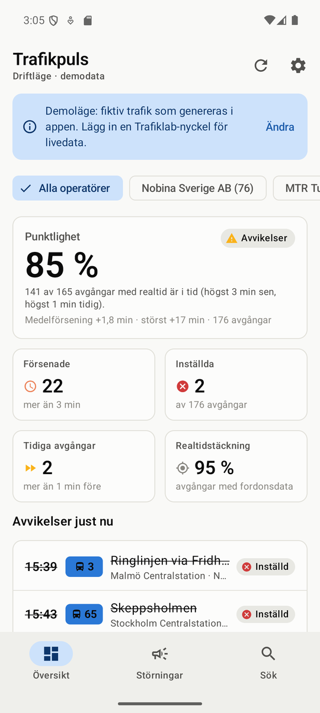
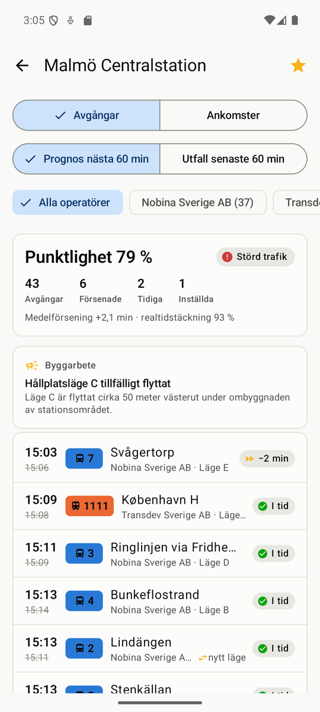
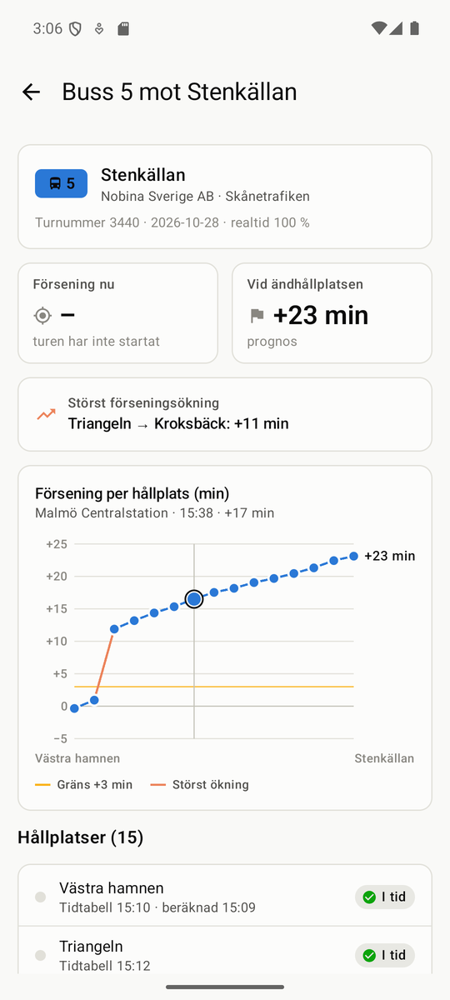
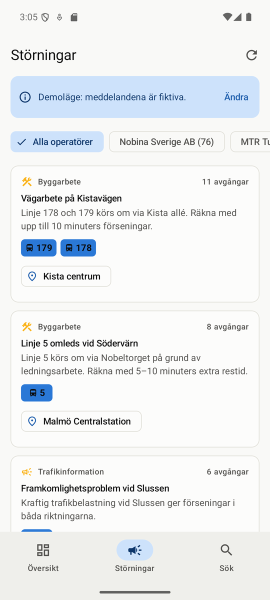
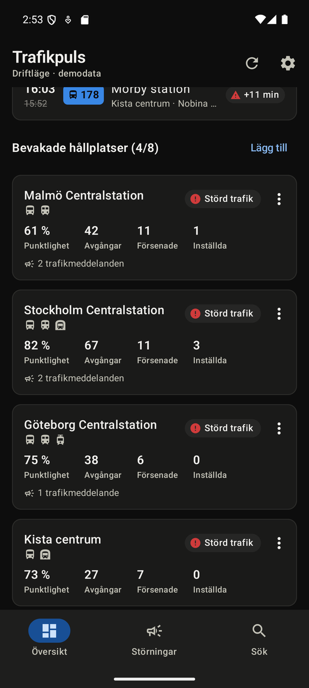

# Trafikpuls – driftövervakning av kollektivtrafik (POC)

Android-app som använder **Trafiklabs öppna realtids-API:er** för operativ uppföljning: punktlighet,
inställda turer, tidiga avgångar, trafikstörningar och realtidstäckning, per knutpunkt och per operatör.
Byggd som proof of concept och intresseanmälan till rollen som utvecklare inom
**Operations Support & IT på Nobina**.

> Inte en officiell Nobina-produkt. Livedata kommer från Trafiklab.se (CC BY 4.0). Demoläget visar fiktiv trafik.

| Driftläge | Hållplats | Tur & förseningsutveckling | Störningar | Mörkt läge |
|---|---|---|---|---|
|  |  |  |  |  |

## Idén – varför just det här?

En resenärsapp visar *när bussen går*. En driftorganisation behöver i stället veta *var trafiken inte går
som planerat, och varför*. Trafikpuls är en mobil "trafikledning i fickan":

- **Operatörsfilter.** Trafiklabs avgångsdata anger kontrakterad operatör per avgång (`agency.operator`,
  t.ex. `"Nobina Sverige AB"`). Därmed kan Nobinas egen trafik följas inom varje trafikhuvudmans data
  (SL, Skånetrafiken, Västtrafik …). Nobina ligger alltid först bland filtren när det finns i datan.
- **Punktlighet som KPI**, beräknad på samma sätt överallt: andelen avgångar *med realtidsdata* som är
  högst 3 min sena och högst 1 min tidiga (gränsen är inställbar). Avgångar utan realtid räknas inte,
  eftersom de annars blåser upp siffran.
- **Tidiga avgångar räknas separat.** En buss som går för tidigt lämnar resenärer kvar på hållplatsen.
- **Realtidstäckning som IT-hälsomått.** Avgångar utan realtidsdata betyder ofta att fordonet inte
  rapporterar sin position (fordonsdator, uppkoppling, inloggning). Det är ett IT-driftproblem snarare
  än ett trafikproblem, och precis den sortens signal som Operations Support behöver.
- **Var på linjen tappas tiden?** Turvyn visar förseningen hållplats för hållplats och markerar
  sträckan där förseningen ökade mest.
- **Bara de linjer du åker.** Per hållplats väljer du vilka linjer och riktningar du följer. Valet gäller
  hållplatsvyn, översiktens siffror och störningsfliken.
- **Varifrån turen kommer.** Varje avgång och ankomst visar var turen startar ("Från Sjöängen") eller
  "Startar här". Turvyn visar start- och sluthållplats med tid.
- **Inget körs i bakgrunden.** Data hämtas bara medan appen är öppen och en vy syns.

## Funktioner

| Vy | Innehåll |
|---|---|
| **Översikt** | Punktlighet (huvudsiffra), försenade, inställda, tidiga avgångar, realtidstäckning. Avvikelser sorterade efter allvarlighet. Bevakade hållplatser med status (Normal drift / Avvikelser / Störd trafik). Uppdateras varje minut medan vyn syns. |
| **Hållplats** | Avgångar eller ankomster. *Prognos nästa 60 min* eller *utfall senaste 60 min*. Varifrån varje tur startar, lägesbyten, trafikmeddelanden, operatör. **Linjer**: välj vilka linjer/riktningar du följer här. |
| **Tur** | Diagram över förseningen längs linjen, störst förseningsökning, försening nu och prognos vid ändhållplatsen. Alla hållplatser i en tabell (diagrammets tillgängliga motsvarighet). |
| **Störningar** | Trafikmeddelanden sammanslagna över alla avgångar och hållplatser, med påverkade linjer och antal avgångar. |
| **Sök** | Sök bland Sveriges hållplatser (rikshållplatser och samlingshållplatser) och bevaka upp till 8. |
| **Inställningar** | API-nyckel, demoläge, punktlighetsgräns. |

**Demoläge:** utan API-nyckel startar appen med fiktiv, deterministisk trafik för fyra knutpunkter.
Demokällan producerar exakt samma JSON-format som Trafiklab, så samma parsning, KPI-beräkning och UI
används. Appen går alltså att visa utan nyckel och utan nätverk.

## Kom igång

1. **Verktyg:** Android Studio (eller JDK 17+ och Android SDK 36). `build-apk.cmd` använder Android
   Studios inbyggda JDK.
2. **API-nyckel (gratis):** skapa konto på [developer.trafiklab.se](https://developer.trafiklab.se),
   skapa ett projekt och lägg till **Trafiklab Realtime APIs** (nivå Bronze).
3. **Lägg in nyckeln** i `local.properties` (git-ignoreras):
   ```properties
   TRAFIKLAB_API_KEY=din-nyckel
   ```
   Alternativt anger du nyckeln i appen under *Inställningar*. Utan nyckel startar appen i demoläge.
4. **Bygg och installera:**
   ```bat
   build-apk.cmd
   adb install -r app\build\outputs\apk\debug\app-debug.apk
   ```
   `build-apk.cmd` kör enhetstesterna och bygger debug-APK:n. En optimerad release-APK (R8, cirka 2 MB)
   byggs med `gradlew :app:assembleRelease`. Den signeras med debug-nyckeln så att den kan sidladdas
   för en demo.

## Arkitektur

```
ui/            Compose-skärmar + ViewModels (StateFlow, enkelriktat dataflöde)
 │
 ├─ data/live/WatchlistMonitor       Delat live-tillstånd för översikt och störningar:
 │                                   samma anrop, samma siffror, serialiserade uppdateringar
 ├─ data/repository/TrafficRepository  Cache → rate limit → retry → stale fallback
 │    ├─ data/source/RemoteTrafiklabDataSource → Retrofit/OkHttp → realtime-api.trafiklab.se/v1
 │    ├─ data/demo/DemoTrafiklabDataSource     → samma DTO-format, offline
 │    └─ data/local (Room)                     → board-cache, bevakningar, linjefilter
 ├─ data/settings (DataStore)        API-nyckel, demoläge, trösklar, operatörsfilter
 │
domain/        Ren Kotlin utan Android-beroenden, enhetstestad:
               PunctualityPolicy/BoardKpis, TripAnalyzer, linje- och operatörsfilter
core/          AppError/Outcome, ErrorMapper, retry med backoff, RateLimiter, TtlCache, tidszon
```

Stack: Kotlin 2.2, Jetpack Compose (Material 3), Navigation (typsäkra rutter), Lifecycle/ViewModel,
Coroutines/Flow, Retrofit + OkHttp + kotlinx.serialization, Room, DataStore.
Beroendeinjektion sker manuellt i `AppContainer` (all konstruktorinjektion kan flyttas till Hilt
oförändrad).

Använda endpoints: `departures/{id}[/{tid}]`, `arrivals/{id}[/{tid}]`, `trips/{tripId}/{datum}`
och `stops/name/{sök}`.

## Robusthet – designbeslut

| Område | Lösning |
|---|---|
| **Kvot** (Bronze: 25 anrop/min, 100 000/mån) | Klientsidig rate limiter (20/min, glidande fönster). 30 s färskhetscache (Trafiklab cachar tavlor i 60 s, så tätare anrop ger inget). Högst 8 bevakade hållplatser. Automatisk uppdatering bara när vyn syns; ingenting körs när appen är stängd. Sökningar har debounce och cache. |
| **Fel** | Transportfel mappas till typade `AppError` med begripliga svenska meddelanden och relevanta åtgärder (t.ex. "Inställningar" vid nyckelfel). Retry med exponentiell backoff och jitter görs bara vid transienta fel (nätverk, 5xx). 401/403 retry:as aldrig. 429 läser `Retry-After`. |
| **Offline** | Senaste lyckade svar sparas i Room. Om uppdateringen misslyckas visas data som är högst 30 min gammal, tydligt märkt ("Sparad data från 14:32 – ingen anslutning"). |
| **Defensiv parsning** | Okända fält ignoreras och `null` ger standardvärden. En trasig avgång tas bort i stället för att fälla hela tavlan. Både `area_type` och `group_type` accepteras (dokumentation och OpenAPI-spec skiljer sig åt). |
| **Samtidighet** | Mutex per tavla: samtidiga anrop för samma tavla slås ihop. Uppdateringar serialiseras med begränsad parallellism (4). Snabba ändringar av bevakningslistan slås ihop. |
| **Tid** | All tid tolkas i `Europe/Stockholm`, oavsett vilken tidszon telefonen har. |
| **Säkerhet** | Nyckeln ligger i git-ignorerad `local.properties` eller i appens privata lagring. Den maskeras i loggar och följer inte med i backup (`allowBackup=false`, data extraction rules). En nyckel som byggs in i en APK kan extraheras, så i produktion bör anropen gå via en backend. |
| **Tillgänglighet** | Färg bär aldrig information ensam (alltid ikon och text). Paletten är validerad för färgblindhet i både ljust och mörkt läge. Diagrammet har en tabell som tillgänglig motsvarighet och en innehållsbeskrivning. |

## Tester och verifiering

```bat
gradlew :app:testDebugUnitTest
```

61 enhetstester täcker parsning av Trafiklabs dokumenterade JSON (inklusive avvikande fält och format),
punktlighets- och statusregler, turanalys, linjefilter och ursprungstext, rate limiter och retry,
samt repositoryt mot en riktig HTTP-stack (MockWebServer). Där testas cache, fallback till sparad data,
401/429/5xx, avbrutna anslutningar, trasig JSON, tidsfönster och att omförsök räknas mot
kvoten. Testerna täcker också live-tillståndet för bevakningslistan (utgången data visas aldrig som
aktuell), demodatans konsistens (tur och tavla stämmer överens) och översiktens tillståndslogik.

Manuellt verifierat i emulator (Pixel 7, Android 15): alla vyer i ljust och mörkt läge, R8-optimerat
release-bygge och riktiga anrop mot Trafiklab (felhantering vid ogiltig nyckel). Android lint ger inga fel.

## Definitioner

- **I tid:** högst *X* min sen (1/2/3/5, standard 3) och högst 1 min tidig.
- **Kraftigt försenad:** 10 min eller mer.
- **Status per hållplats:** *Störd trafik* om punktligheten är under 75 % eller om minst 5 % av
  avgångarna är inställda eller kraftigt försenade. *Avvikelser* om punktligheten är under 90 % eller
  om någon avgång är inställd eller kraftigt försenad. Annars *Normal drift*.
- **Prognos / utfall:** API:t returnerar alltid ett 60-minutersfönster. *Nästa 60 min* är prognoser,
  *senaste 60 min* är utfall.

## Förslag på vidareutveckling

1. **Fordonskarta** med GTFS Regional Realtime (`VehiclePositions`): se vilka fordon som står still
   eller har slutat rapportera.
2. **Realtidstäckning per fordon och tur** med larm när ett fordon tappar realtid, alltså tidig
   upptäckt av fel i fordons-IT.
3. **Historik och trender** från Trafiklab KoDa: punktlighet per linje och timme, jämfört med
   avtalade kvalitetsmål.
4. **Central backend** (t.ex. .NET/Azure) som pollar en gång för alla användare: en nyckel, ingen kvot
   per enhet, push via FCM och larm till trafikledningens Teams-kanal.
5. Fler källor: SL Deviations, Trafikverkets vägtrafikstörningar.
6. Teknisk skuld som medvetet lämnats i POC:n: Hilt, CI (GitHub Actions), Compose UI-tester,
   strängar i `strings.xml` för flerspråkighet.

## Data och licens

Livedata från [Trafiklab.se](https://www.trafiklab.se) (Trafiklab Realtime APIs) under
[CC BY 4.0](https://creativecommons.org/licenses/by/4.0/). Attribution visas i appen. Demoläget
använder verkliga platsnamn men fiktiva linjer, operatörstilldelningar och störningar.
